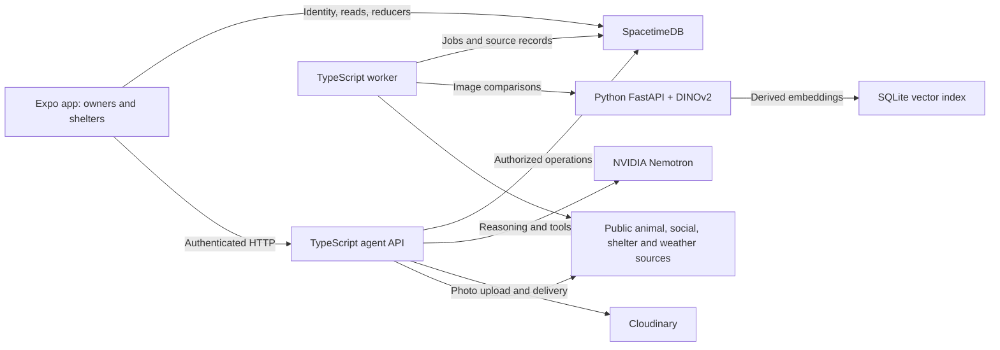

# PawSafe (PetsAndFound)

PawSafe helps people prepare for disasters and reunite lost pets with their families. Pet owners can register pets, file lost or found reports, explore nearby shelters, review possible photo matches, and practice emergency decisions. Shelter staff can coordinate cases and capacity. An AI assistant can search available sources and guide a user through these workflows; people review consequential actions and proposed matches.

## Incident command expansion

Verified shelter staff can open an incident around their shelter. Existing and incoming nearby found-animal cases appear on its command board, with an unattended 15-minute queue. Urgent cases notify nearby verified staff; the worker escalates unassigned cases. PawTricia prepares an evidence-backed response plan from the report, possible matches, official weather alerts, current capacity, and shelter supplies. Staff review the plan and explicitly accept or transfer the case. A shelter can register animals in care, publish food/crate/medical-kit counts, and message the reporter through the case. Confirmed matches also have a private reunification thread for the owner, finder and handling shelter. Pet profiles include gender, and new disaster drills include a fourth shelter-coordination decision.

The found-animal form offers opt-in camera scene assist. It samples a frame every 15 seconds while enabled and uses `NVIDIA_VISION_MODEL` to describe visible surroundings. It does not diagnose an animal or dispatch responders. The reporter selects the condition used for urgency. On mobile, the Notifications screen can register an Expo push token and schedule seven rotating weekly preparation tips. Owners can opt in to official weather alerts for a chosen area from Prepare. Native push delivery needs an EAS project ID (`EXPO_PUBLIC_EAS_PROJECT_ID` in the app build), push credentials, and a development or production build; Android Expo Go does not support remote push notifications.

For a repeatable surge demonstration, use a **disposable local SpacetimeDB database** with `SPACETIME_URI` set to a loopback URL, `SPACETIME_DATABASE` set to that database, `DEMO_REVIEWER_TOKEN` set to its publisher or reviewer, and `SPACETIME_SERVICE_TOKEN` set to a granted service identity. Build the agent and database module, then run `node --env-file=.env scripts/seed-incident-demo.mjs --count=500 --images` (up to 1,000 reports). The image mode requires Cloudinary credentials in the environment. The script creates three verified **SIMULATED** shelters, 40 paired duplicate sightings, a critical reporter-supplied injury, and 500–1,000 labeled reports. It fetches 41 images from the [Oxford-IIIT Pet dataset](https://www.robots.ox.ac.uk/~vgg/data/pets/) through a pinned [Hugging Face mirror](https://huggingface.co/datasets/timm/oxford-iiit-pet), caches them in ignored `.demo-images/`, and uploads private copies for the critical report, 40 duplicate pairs, and one simulated lost pet. Oxford lists the dataset under [CC BY-SA 4.0](https://creativecommons.org/licenses/by-sa/4.0/) and notes that copyright remains with the original image owners. The images are illustrative; none establish an injury or a pet's identity. Source IDs and attribution appear in the simulated reports and command board.

The script saves local demo identities in `.demo-incident.json` with owner-only file permissions; keep that file private. Open Incident command as the Central shelter manager using its account key from the manifest. That demo account is also a staff member at East shelter, so it can switch organizations in the shelter dashboard. With the vision service running, use `node --env-file=.env scripts/seed-incident-demo.mjs --match` to score the simulated lost/found photo pair; the board shows a **possible** visual match for human review. Run the script with `--fill` to fill Central and show the stale plan and re-plan to East. **For a hands-on demo, stop here:** switch the app to East shelter and use **Accept case for our shelter** on the critical case. Run `--review` only for an automated acceptance or to print the metrics after a person accepts; `--release` returns a scripted acceptance to the open incident queue. The board refreshes every five seconds and shows median time to first review, urgent unassigned cases, and cases with no case update for 15 minutes. The last metric uses real timestamps and rises after 15 minutes without an update. Run the script with `--cleanup` afterward. Cleanup closes reports and the incident, revokes demo shelter verification, removes uploaded demo images, and deletes the token manifest; use the disposable database to remove remaining test records. Running without `--images` keeps the original text-only demo mode.

To add owner-to-shelter examples to an existing simulated incident, run `node --env-file=.env --env-file=.demo-run.env scripts/seed-incident-demo.mjs --owners` while the vision service is running. This adds **SIMULATED Maya Reed / Biscuit** and **SIMULATED Jordan Lee / Scout**. Each account has a pet passport with three different views of its dog and a lost report. East and North shelter each receive a found case with a fourth view of the respective dog and an in-care shelter registry entry. The script scores both pairs and leaves the visual match proposals pending staff review. Owner account keys, pet IDs, report IDs, and case IDs are saved in the private `ownerPets` array in `.demo-incident.json`; the stage can be rerun safely. The eight selected photos come from identity-labeled folders in the [DogReID-1553 dataset](https://doi.org/10.7910/DVN/LVTRLG), which is published as [CC0 1.0](https://creativecommons.org/publicdomain/zero/1.0/). `scripts/fetch-dogreid-demo.py` reads only the selected photos from the public archive using HTTP ranges and caches them in ignored `.demo-images/dogreid/`. The owner names and Dallas sightings are fictional; a dataset label supports the demo pairing, while actual reunions still require a person to verify identity.

This repository contains the Expo client, the authoritative SpacetimeDB module, a TypeScript API and background worker, and a Python image matching service. The [architecture plan](PLAN.md) describes the broader product design; this README describes the code currently in the repository.

## Architecture



- **Client (`app/`):** React Native screens for owner, shelter, reporting, chat, maps, preparedness, and simulations. Expo Router handles navigation. The client talks to SpacetimeDB and the agent API.
- **Application state (`spacetimedb/`):** Tables, reducers, authorization, and read procedures for users, pets, photos, reports, matches, shelters, cases, notifications, and simulations.
- **API and orchestration (`services/agent/`):** Authenticated HTTP endpoints, Nemotron tool orchestration, photo upload signing, source integrations, and simulation endpoints. Its separate worker imports external records and processes matching jobs.
- **Vision (`services/vision/`):** FastAPI service that preprocesses pet photos, generates DINOv2 embeddings, ranks candidates, and persists derived vectors in SQLite. Similarity is evidence for a possible match, not an identity decision.

## Tech stack

| Area | Technology |
| --- | --- |
| App | React Native, Expo 58, Expo Router, TypeScript, `react-native-maps` |
| Database and access rules | SpacetimeDB 2.14.1 TypeScript module |
| API and worker | Node.js, TypeScript, Zod |
| AI assistant | NVIDIA Nemotron API |
| Image matching | Python, FastAPI, PyTorch, DINOv2 Base, SQLite |
| Photo storage | Cloudinary |
| External information | RescueGroups, Bluesky, Dallas Open Data, OpenStreetMap/Photon, NOAA/NWS, FEMA |

External APIs and model features require their corresponding credentials and services. The UI can be previewed separately, but end-to-end reporting and matching require the backend components.

## Repository layout

| Path | Purpose |
| --- | --- |
| `app/` | Expo mobile and web client |
| `spacetimedb/` | Database module and domain operations |
| `services/agent/` | HTTP API, agent orchestration, source providers, and worker |
| `services/vision/` | Image embedding and similarity service |
| `scripts/` | Backend verification |
| `PLAN.md` | Detailed product and architecture plan |

## Start locally

For a client preview, use Node.js 24 and run from the repository root:

```sh
npm ci --prefix app
npm run app:web
```

Expo prints the local web URL (normally `http://localhost:8081`). For a device or simulator, use `npm run app` instead. The client defaults to the `petlovers-mlcfo` database on SpacetimeDB Cloud and the agent API at port 8080 on the development host; `EXPO_PUBLIC_SPACETIME_URI`, `EXPO_PUBLIC_SPACETIME_DATABASE`, and `EXPO_PUBLIC_AGENT_URL` can override those defaults.

The published cloud module is at `https://spacetimedb.com/@mattarithwik/petlovers-mlcfo`. The root `.env` selects `https://maincloud.spacetimedb.com` and `petlovers-mlcfo` for the locally run API and worker. Keep `SPACETIME_SERVICE_TOKEN` in that ignored file; it must belong to an identity granted the `service` role in this database. Run the API and worker with `node --env-file=.env` as shown below. The Expo client connects directly to cloud, while the agent API and vision service still need their own running endpoints.

Select **Try a practice drill** on the welcome screen or open `/practice` to play without signing in. The device keeps the six most recent local drills. The owner's Simulation tab saves connected runs to the account and offers a Nemotron debrief on completion.


For the complete local stack, use Node.js 24, the SpacetimeDB 2.14.1 CLI, and either Docker or a Python environment with the dependencies in `services/vision/requirements.txt`. Run from the repository root.

```sh
npm ci --prefix spacetimedb
npm ci --prefix services/agent
npm run build
spacetime start
```

In another terminal publish the database to the running local server. Keep the publisher identity available for granting service and reviewer access.

```sh
spacetime publish pawsafe --module-path spacetimedb --server local
```

Copy `.env.example` to `.env`. Create a dedicated worker identity on the **same SpacetimeDB instance**. In PowerShell, the following requests a new identity without printing its bearer token.

```powershell
$service = Invoke-RestMethod -Method Post -Uri 'http://127.0.0.1:3000/v1/identity'
$service.identity
```

Grant that identity the service role using the **publisher's** credentials. The following example uses the HTTP API with the publisher token supplied through the current shell environment.

```powershell
$payload = @{ identity = $service.identity } | ConvertTo-Json -Compress
Invoke-RestMethod -Method Post -Uri 'http://127.0.0.1:3000/v1/database/pawsafe/call/grant_service_identity' -Headers @{ Authorization = "Bearer $env:SPACETIME_PUBLISHER_TOKEN" } -ContentType 'application/json' -Body (ConvertTo-Json -InputObject @($payload) -Compress)
$env:SPACETIME_SERVICE_TOKEN = $service.token
```

Set `SPACETIME_SERVICE_TOKEN` in the API and worker environments. Give both services the same strong `INTERNAL_SERVICE_SECRET` as vision. Configure NVIDIA for chat, Cloudinary for photo uploads and RescueGroups for its directory and animal feed. Set `PROVIDER_USER_AGENT` to an application name and monitored contact for public APIs.

Build the vision image and mount a named volume. The first inference downloads the pinned model and persists it in that volume. For offline hosting, point `DINO_MODEL_DIR` at a mounted copy of the model.

```sh
docker build -t pawsafe-vision services/vision
docker run --rm -p 127.0.0.1:8000:8000 -e INTERNAL_SERVICE_SECRET --mount source=pawsafe-vision-data,target=/data pawsafe-vision
```

With Python, install `services/vision/requirements.txt`, export `INTERNAL_SERVICE_SECRET`, and run `python -m uvicorn main:app --port 8000` from `services/vision`. Set `VISION_INDEX_PATH` to a persistent path. Start the API and worker in separate terminals.

```sh
node --env-file=.env services/agent/dist/server.js
node --env-file=.env services/agent/dist/worker.js
```

The API defaults to port 8080. Both services expose `GET /health` for liveness. Each source search returns its own availability and provenance. Cloudinary, NVIDIA, and source credentials belong in the backend environment.

If Bluesky requires an authenticated search, set `BSKY_PDS_URL` and a server-side `BSKY_ACCESS_JWT` issued for that PDS. Review externally licensed photos with `review_external_photos` before using them for automatic comparisons.

The Expo app lives in `app/`. From the repository root, run `npm run app` (or `npm run app:web`) after `npm install` inside `app/`.

## Client integration

The Expo client calls SpacetimeDB reducers and read procedures over HTTP. Each reducer takes a JSON-encoded payload as its sole argument. The `api_read` procedure takes a resource and a key and returns JSON text. A single authenticated WebSocket subscribes to the user's views and public directory updates. Screens reload their authorized reads on changes, reconnect and foreground, with polling as a fallback.

Users create a username and password during onboarding. The agent service's `POST /v1/auth/register` binds those credentials to their authenticated Spacetime identity; `POST /v1/auth/login` returns that identity's token after password verification. Passwords are hashed with scrypt by the service, and the private Spacetime credentials table is limited to the service identity. Existing account-key users can still sign in with their key and add credentials in Account. A selected owner or shelter view does not grant shelter permissions; verified staff membership and reviewer grants are checked by SpacetimeDB.

1. Call `register_user` with `{name,generalLocation}`, then `register_pet` with a client-generated ID, name and species.
2. Call `POST /v1/uploads/sign` with `{}`. Send the returned fields and image file as multipart form data to `uploadUrl`. On successful upload, call `attach_pet_photo` with `{id,petId,storageKey,angle,animalCount}`. Use the returned photo ID. Supply an animal count only when someone has checked the image. An authorized client can obtain a short-lived delivery URL from `GET /v1/photos/<photoId>/url`.
3. Use the report reducers directly after confirmation, or use the agent flow below. The worker compares eligible images with open lost reports. The match includes the candidate and reference photo IDs, numerical evidence and review status. Owners and authorized staff can review the proposal.
4. For shelter operations, register an organization, submit it for review, then have an authorized reviewer verify it. Verified staff can manage capacity, assignments and case resolution. External directory syncs cannot confer staff privileges or set capacity.

Send the SpacetimeDB user token as `Authorization: Bearer <token>` on the Node API. POST requests use JSON.

| Endpoint | Request |
| --- | --- |
| `POST /v1/agent/message` | `{requestId,message,previousRunId?,context?}`. Supply a fresh UUID for each message. Context can contain `location:{latitude,longitude}`, city, uploaded photos or an authorized report ID. |
| `POST /v1/agent/confirm-action` | `{runId,confirmed:true}` after showing the complete returned pending action to the user. Reuse the same run ID on retry. |
| `GET /v1/agent/runs/<id>` | Owner-scoped run, tool outcomes and pending or completed actions. |
| `POST /v1/matching/search` | `{reportId}` for a report the caller can access. |
| `POST /v1/ingestion/bluesky/search` | `{city,species,breed?,since?,limit?}`. |
| `POST /v1/ingestion/shelters/sync` | `{latitude,longitude,radiusKm?,limit?}`. |
| `POST /v1/ingestion/animals/search` | Same location parameters, with optional species. |
| `GET /v1/weather/alerts` | `latitude` and `longitude` query parameters. Official NWS records include timestamps. |
| `GET /v1/disasters/history` | Two-letter `state` and optional `incidentType` and ISO `since`. |
| `GET /v1/scenarios` | Six fictional drills with deterministic, branching decisions. |
| `POST /v1/simulations` | Use `{id,scenarioId,animal?}` with a client-generated UUID. Scenarios are `tornado`, `wildfire`, `winter_storm`, `earthquake`, `flood` and `heat`. Companions are `dog` (default), `cat`, `snake`, `bird` and `rabbit`. |
| `GET /v1/simulations/<id>` | Current scene, companion, choices, revision, decision count and scores. New runs have four decisions. Earlier two- and three-decision runs retain their scores. |
| `POST /v1/simulations/<id>/choices` | `{choiceId,revision}` from the current scene. |
| `POST /v1/simulations/<id>/feedback` | `{}` for a completed run. Nemotron explains the recorded decisions and score; `generatedBy` is `nemotron`, and `source` remains the scenario guidance URL. |
| `POST /v1/response/plan` | `{caseId}` for a case visible to the caller. Queues a PawTricia operations run and returns `{caseId,status:"queued"}`. |
| `POST /v1/scene/assess` | `{imageBase64,condition}`. Uses the configured vision model to describe one camera frame without changing reporter urgency. |

### Matching and source permissions

Public posts and shelter listings retain source links. External image processing requires both an approved rights holder in `EXTERNAL_IMAGE_RIGHTSHOLDERS` (for example `rescuegroups:123`) and an exact HTTPS CDN hostname in `EXTERNAL_IMAGE_HOSTS`. New source matches and animal identities require human review. The worker records possible matches by default. Set `MATCH_NOTIFY_THRESHOLD` after evaluating labeled photo pairs to enable score-triggered owner notifications.

### PawTricia operations

Every new found report queues an operations run, including ordinary cases outside an incident. Shelter capacity updates, intake, discharge, verification changes and supply updates requeue open found cases within 50 km, cases assigned to that shelter, and cases whose existing plan suggests that shelter. Report and camera-assessment updates also requeue the case. The worker backfills existing found cases on startup and polls the durable queue every five seconds between operation batches, independently of ingestion and matching jobs.

Nemotron requests `inspect_case`, `check_matches`, `find_shelter_capacity` and `check_weather`. These execute the existing visual matcher, verified shelter capacity/resource checks, and NWS provider. `save_recommendation` validates a structured result containing urgency, a possible match, a suggested destination, reasons, missing information and the next action. Match and destination IDs must come from tool evidence. Destinations require capacity and supplies updated within 24 hours and must be within 50 km. Staff confirm intake and transport.

Each run saves tool results and timestamps as checks complete. The case screen displays the recommendation, source failures, recorded tool steps and the ten most recent runs. `case_operations` is scoped to the reporter, assigned shelter staff, or verified staff viewing an open unassigned case; private report notes are hidden from unassigned staff. Existing response-plan review actions remain available.

If Nemotron is unavailable or returns only prose, required tools still execute and the worker records a recommendation from their evidence with a `degraded` status. Failed sources are recorded as missing information. Database or case-read failures retry with backoff; expired worker leases can be reclaimed. Events increment a case's queue version, so an older run is retained as `superseded` and cannot publish over newer capacity or report evidence. Run the agent worker alongside the API; configure `NVIDIA_API_KEY`, `NVIDIA_MODEL`, and the existing vision and database settings for full execution.

### Verification

```sh
npm test
npm run build
spacetime build --module-path spacetimedb
node scripts/verify-backend.mjs spacetimedb/dist/bundle.js
```

The verification script uses an isolated database on a loopback SpacetimeDB instance and removes that database when finished. Set `TEST_SPACETIME_URI` to use another local port. Set `TEST_IMAGE` to a local test photo and point `VISION_SERVICE_URL` and `INTERNAL_SERVICE_SECRET` at a local vision instance to also exercise real embedding, matching, persistence and worker acknowledgement.

From `services/vision`, run `python -m pip install -r requirements-test.txt` and `python -m unittest -v` for vision API tests. Run `python evaluate.py evaluation-sample.json --fetch` to exercise the ranking metrics with the labeled sample. Use representative labeled data, including animals absent from the gallery, before choosing a notification threshold.

The [database API reference](spacetimedb/README.md) lists reducer payloads, authorization rules, and subscription views. The [architecture plan](PLAN.md) describes the product workflows.
